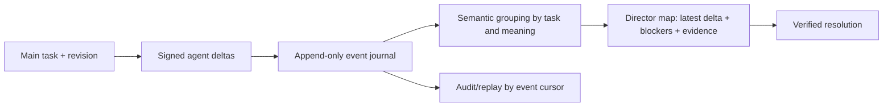

# Director delta feed and clock safety

## Intended behavior

The Director should present a path from the main task to its verified
resolution, not a wall of simultaneous agent pings:

Each event should identify the task and revision it builds on, its author,
parent event or commit, a concise delta, and links to evidence or verification.
The Director can group related deltas into one task card, collapse repeated
heartbeats, and surface only new information, blockers, conflicts, and verified
state changes. Keep the original events immutable and retrievable: semantic
summaries help navigation but do not become the source of truth.

## Ordering and clock model

Do not use synchronized wall-clock time as the event ordering mechanism.
Chrony may step the system clock when configured or commanded to do so; a
system clock step is not a rollback of Git, SQLite, or an already committed
event. On Linux, `CLOCK_MONOTONIC` is not subject to discontinuous wall-clock
jumps, but its epoch is local to a boot and cannot order events across hosts.

Use these separate fields and rules:

- **Per-agent sequence**: persistent, strictly increasing, with unique
  idempotency keys. Reject replays and gaps that require a resend.
- **Journal cursor**: a database append position for replaying the shared
  event log. A cursor is global to that database; per-agent sequence numbers
  are not globally comparable.
- **Causality**: reference the parent event/revision. For multi-host merges,
  add a Lamport or hybrid logical clock and use deterministic tie-breaking;
  preserve causal parent links.
- **Durations and local leases**: use monotonic time on the service that owns
  the lease. Persist lease owner/revision and validate it transactionally.
- **Display timestamps**: store UTC wall time with source and clock-quality
  metadata for logs and human review. Do not let a timestamp alone authorize a
  write or determine which repository state wins.

Chrony/NTP keeps clocks close enough for human-readable timestamps and
cross-system correlation. It does not make a distributed event order safe.
Configure time correction deliberately; avoid issuing `makestep` during active
work if a step could confuse timestamp-based expiry or dashboards. More
importantly, make writes resilient to any wall-clock correction: use
idempotency, optimistic concurrency against the expected task/repository
revision, and atomic commits/deploys. Reconciliation must not restore an older
revision just because its timestamp appears newer.

## Heartbeat and swarm display

The heartbeat is a liveness/refresh signal, not the swarm's shared transaction
clock. Agents can heartbeat at different rates. The UI may refresh or aggregate
at a fixed display tick (for example, 2–4 times per second), but incoming events
must be queued and persisted independently. Deduplicate heartbeats by
agent/task, throttle repeated status text, and let a human expand raw events
when needed. Never drop a state transition, review decision, conflict, or
verification artifact to keep the map visually quiet.

For “main task = delta + delta + delta → resolved”, task completion should be
computed from accepted, causally linked events plus required checks, not from
an agent's prose summary. Failed checks and conflicting branches remain
visible as blockers until a later event resolves them.

## What exists today

`coordination_bus/bus.py` already has signed event envelopes, per-agent
sequences, idempotency keys, task/review/conflict event types, and a verified
row-id replay cursor. The Arc API now provides Nomic-backed semantic search
over explicitly indexed text segments. These can supply the journal and
relevance layer for a Director.

The full Director map/aggregation UI, semantic grouping of live coordination
events, cross-host Lamport/HLC timestamps, and verified task-resolution
reducer are not yet implemented. Do not describe the design as a running
multi-agent Director. Review the bus's wall-clock `issued_at`/expiry and task
lease handling before using it across machines with possible clock skew.

## References

- [chrony `chronyc` manual](https://chrony-project.org/doc/4.6/chronyc.html) — clock stepping can be forced by `makestep`.
- [chrony configuration manual](https://chrony-project.org/doc/4.6.1/chrony.conf.html) — correction can step or slew the clock.
- [Linux `clock_gettime(2)` manual](https://www.man7.org/linux/man-pages/man2/clock_gettime.2.html) — `CLOCK_MONOTONIC` is not affected by discontinuous wall-clock changes.
- [RFC 5905](https://www.rfc-editor.org/rfc/rfc5905) — NTPv4 protocol and clock discipline.
